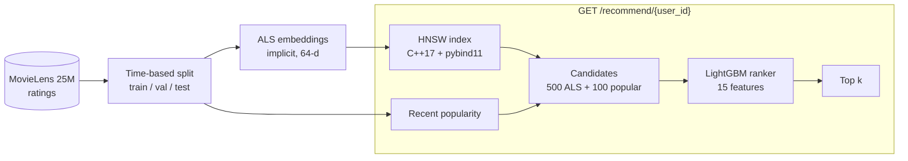
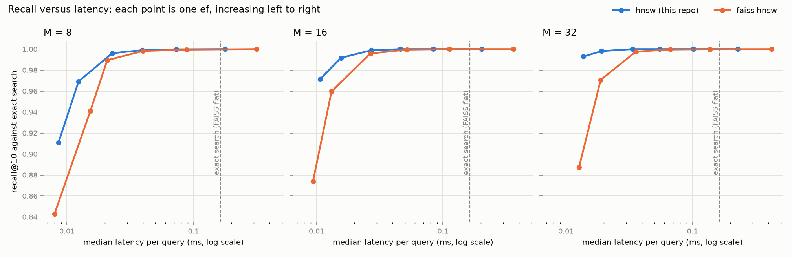

# hnsw-recsys

A two-stage movie recommender on MovieLens 25M: matrix-factorisation embeddings,
approximate nearest-neighbour retrieval with an HNSW index written in C++17, and
LightGBM re-ranking, served over HTTP. Every stage is scored on the same users
with a time-based split and compared with a popularity baseline.

## Architecture



| Path | Contents |
|---|---|
| `src/recsys/` | Data, split, metrics, baseline, ALS, features, ranker, serving pipeline, FastAPI app |
| `cpp/` | HNSW index (`include/`, `src/`), pybind11 bindings (`python/`), GoogleTest suite (`tests/`) |
| `benchmarks/` | ANN benchmark against FAISS and exact search; HTTP load test |
| `tests/` | pytest suite on small synthetic data |
| `results/` | One JSON per run with metrics, parameters, seed, hardware, library versions and git commit |

## Results

All quality numbers are on the test window (ratings from 2018-01-04 onwards),
for the 6,330 users who have earlier history and at least one liked film
(rating >= 4.0) in the window. Models see only ratings before the cutoff.

### Recommendation quality by stage

| Stage | Recall@10 | NDCG@10 | Recall@50 | NDCG@50 | Offline ms per user |
|---|---|---|---|---|---|
| Popular, all time | 0.0278 | 0.0778 | 0.0849 | 0.0790 | not measured |
| Popular, last 30 days (baseline) | 0.0545 | 0.1239 | 0.1604 | 0.1336 | not measured |
| ALS, exact search | 0.0528 | 0.1419 | 0.1505 | 0.1396 | 0.673 |
| ALS, HNSW search (ef = 100) | 0.0528 | 0.1419 | 0.1506 | 0.1397 | 0.437 |
| ALS + popular candidates, LightGBM re-ranked | 0.0795 | 0.1771 | 0.2091 | 0.1845 | 7.883 |
| Served pipeline (HNSW + LightGBM) | 0.0794 | 0.1771 | 0.2088 | 0.1843 | 3.48 |

"Offline ms per user" is the evaluation loop's time per user, including
filtering in Python; it is not HTTP latency. The re-ranked row uses LightGBM's
default threading and the served row one thread per request, which is why the
served row is faster.

The re-ranker is 46% above the baseline on Recall@10 and 43% on NDCG@10. ALS on
its own does not beat recent popularity on recall.

### HNSW index against exact search and FAISS

31,217 item vectors of dimension 64, 1,000 user vectors as queries, inner
product, one thread, one query per call from Python, fastest of three runs per
query. Recall here is overlap with the exact top 10, not recommendation quality.



At M = 16, ef_construction = 200:

| Method | ef | Recall@10 | Median latency | p95 latency | Build |
|---|---|---|---|---|---|
| NumPy exact | – | 1.0000 | 0.4026 ms | 0.5026 ms | – |
| FAISS flat (exact) | – | 1.0000 | 0.1603 ms | 0.2032 ms | – |
| This index | 20 | 0.9917 | 0.0145 ms | 0.0182 ms | 4.34 s |
| This index | 50 | 0.9989 | 0.0265 ms | 0.0328 ms | 4.34 s |
| FAISS HNSW | 20 | 0.9597 | 0.0135 ms | 0.0163 ms | 2.92 s |
| FAISS HNSW | 50 | 0.9958 | 0.0269 ms | 0.0295 ms | 2.92 s |

On this benchmark the index is in the same range as FAISS HNSW. That is one
small dataset on one ARM laptop, timed through Python, with a similarity FAISS's
HNSW is not tuned for; it is not evidence of a general advantage. FAISS builds
its graph faster.

### HTTP latency under load

`GET /recommend/{user_id}?k=10`, 3,000 requests per level for randomly chosen
known users, one uvicorn worker running in WSL2, load generator on the same
machine.

| Concurrent requests | p50 | p95 | p99 | Requests per second | Errors |
|---|---|---|---|---|---|
| 1 | 12.24 ms | 25.16 ms | 33.14 ms | 71.5 | 0 |
| 8 | 40.03 ms | 186.92 ms | 334.67 ms | 130.3 | 0 |
| 32 | 281.72 ms | 1,192.49 ms | 1,816.42 ms | 76.7 | 0 |

## Design trade-offs

- **Global time split, not leave-last-out.** One cutoff for everyone mirrors
  deployment and cannot leak another user's future. The cost is a small
  evaluable set: 11,946 users with liked films in the test window have no
  earlier history and are not scored, and 12.6% of the liked films in the
  window did not exist before the cutoff, so no model here can reach them.
- **Three windows.** The ranker learns on the validation window from
  embeddings and features built on the train window alone. Reusing the
  embeddings fitted on train + validation would leak the labels.
- **Inner product in the index.** ALS scores are dot products, so the index
  searches by negated dot product. That is not a metric, which matters for the
  neighbour heuristic below.
- **Filtering after the search.** The index cannot skip films a user has
  already rated, so retrieval asks for `k + number of seen films` and filters.
  This is simple and exact enough, but it widens the search for heavy users.
- **Candidates from two sources.** Popular recent films are added to the ALS
  candidates because popularity finds films ALS misses. The 600 candidates
  contain 51.3% of the films users went on to like, which caps the ranker.
- **Index rebuilt at start-up.** The index has no serialisation; building it
  for 31,217 items takes about 4 seconds, inside a 6.8 second start-up.
- **Plain scalar distance loop.** The index has no SIMD code and allocates a
  visited list on every layer search. Both are fine at this size and would be
  the first things to change for a much larger index.

## What didn't work

- **ALS did not beat recent popularity on recall** (0.0528 against 0.0545 at
  10). Under a time split, what is popular now is a strong signal and ALS has
  no notion of time. It did win on NDCG, and the two signals combine well in
  the ranker, whose top features by gain are likes in the last 30 days (36%)
  and ALS rank (22%).
- **The paper's neighbour-selection heuristic (Algorithm 4) made the index
  worse on these vectors.** At M = 16, ef = 20 recall fell from 0.9917 to
  0.9575 and the median latency rose from 0.0145 ms to 0.0262 ms. Its recall
  is close to FAISS HNSW's, which uses the same rule. Why it is also slower
  was not investigated. It is kept as an option, off by default.
- **The index barely matters at this scale.** Inside the recommender, HNSW and
  exact search give the same quality to within 0.0001, and exact search over
  31,217 items already takes a fraction of a millisecond. The index would pay
  off with millions of items.
- **One server process does not scale with concurrency.** Throughput peaks at
  8 concurrent requests and falls at 32, with p95 above one second. The likely
  cause is Python's global interpreter lock; this was not profiled. Running
  several worker processes is the obvious next step and was not measured.
- **A wider ALS grid helped only a little.** The first grid's best confidence
  weight sat at its lower edge; adding lower values moved test Recall@10 from
  0.0515 to 0.0528 and Recall@50 from 0.1539 to 0.1505.

## Reproduce

Linux, Python 3.11 or newer, a C++17 compiler.

```bash
python3 -m venv .venv && source .venv/bin/activate
make setup          # Python dependencies, CMake, pybind11
make test           # pytest
make cpp-test       # GoogleTest
make m1             # download + split + popularity baseline
make m2             # ALS grid on validation, test score, embeddings
make m4             # bindings, HNSW retrieval quality, ANN benchmark and plot
make m5             # LightGBM re-ranking
make m6-export      # serving files + served-pipeline quality
make serve          # API on 127.0.0.1:8000 (in another terminal)
make m6-load        # HTTP latency under load
```

`make m1` downloads `ml-25m.zip` (about 250 MB) and checks it against the MD5
published by GroupLens. `make m6-load` records how the server was started; pass
your own description with `python benchmarks/load_test.py --server "..."`.

## Environment for the numbers above

| | |
|---|---|
| Dataset | MovieLens 25M, 25,000,095 ratings; zip SHA-256 `8b21cfb7eb1706b4ec0aac894368d90acf26ebdfb6aced3ebd4ad5bd1eb9c6aa` |
| Split | Train before 2016-06-25, validation to 2018-01-04, test after (80 / 10 / 10 by timestamp) |
| Machine | Qualcomm ARM64 laptop, 12 logical cores, 7.9 GB RAM available to WSL2 |
| OS | Ubuntu 24.04 on WSL2, kernel 6.6.87.2 |
| Software | Python 3.12.3, NumPy 2.5.4, implicit 0.7.3, FAISS 1.15.1, LightGBM 4.7.0, pybind11 3.1.0, FastAPI 0.143.0 |
| Seed | 0 everywhere |
| ALS | 64 factors, regularisation 0.1, alpha 3, 15 iterations, chosen by validation Recall@10 over 24 settings |
| HNSW in the pipeline | M = 16, ef_construction = 200, simple neighbour selection |
| Ranker | LambdaRank, learning rate 0.05, 63 leaves, early stopping on 20% of validation users, 102 trees |

Each file in `results/` records the exact parameters and the git commit of the
run that produced it.

## References

- Y. Malkov, D. Yashunin. Efficient and robust approximate nearest neighbor
  search using Hierarchical Navigable Small World graphs. arXiv:1603.09320.
- Y. Hu, Y. Koren, C. Volinsky. Collaborative Filtering for Implicit Feedback
  Datasets. ICDM 2008.
- F. M. Harper, J. A. Konstan. The MovieLens Datasets: History and Context.
  ACM TiiS, 2015.
